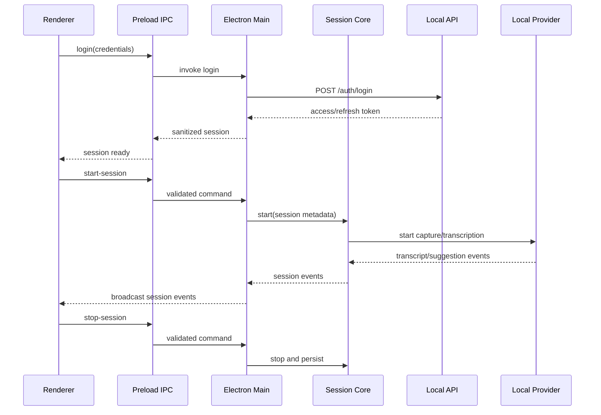

# InterviewCoder 本地重建设计

日期：2026-11-09
状态：本地重建流程已实现，待用户审阅
目标仓库：`xh722/coding-help`

## 目标

在不运行原始安装包、不依赖原版服务端、不复制原版私有代码的前提下，构建一个可运行的本地 Electron 重建版本。它复刻已从安装包确认的桌面交互边界：登录和会话状态、Dashboard、Overlay、截图/录音抽象、转写事件、建议流、暂停/恢复、会话结束和本地记录。

原版的服务端 AI、账户系统、Recall 云上传和 Windows native agent 只通过适配器表达，不在第一版中伪造其私有实现。后续在授权 Windows 隔离环境中取得动态证据后，再按证据替换适配器。

## 成功标准

1. 在本地启动命令后，用户可以进入登录页、登录本地测试账户并看到 Dashboard。
2. 用户可以打开带明确隐私指示器的 Overlay，切换显示/隐藏、调整大小、移动到显示器。
3. 用户可以创建、暂停、恢复和结束会话；会话状态转换可持久化并能在重启后恢复最近记录。
4. 本地 provider 能生成确定性的转写事件和建议事件，整个流程无需网络。
5. Electron 主进程只接受白名单 IPC；renderer 不获得 Node.js 或任意命令执行能力。
6. 核心状态机、认证存储、IPC 校验、local API 和 provider 适配器都有自动化测试。
7. 仓库中不提交原始安装包、完整 ASAR、native DLL/GStreamer 文件或任何真实账户令牌。

## 范围

### 第一阶段：本地重建

- Electron 主进程和窗口管理。
- Preload context bridge 与 IPC allowlist。
- 登录、刷新、退出和本地 token 存储。
- Dashboard 和 Overlay 的基础界面。
- 本地 session 状态机。
- 截图能力接口；Electron 环境可使用 `desktopCapturer`，测试环境使用确定性图片 provider。
- 录音能力接口；第一版使用测试音频/PCM 事件，真实设备采集通过 provider 接入。
- 本地转写 provider 和建议 provider。
- 本地 HTTP API，提供登录、用户、会话、转写和建议接口。
- 会话记录和导出 JSON。

### 第二阶段：原版动态验证

- Windows VM 中观察原版安装、进程树、IPC、agent stdin/stdout、临时文件和网络请求。
- 对比原版行为与本地 provider 的输入/输出。
- 仅把有证据的行为加入兼容适配器。

### 明确不包含

- 原版服务端代码或数据库恢复。
- 原版账户、订阅、付费限制或真实 token 的复制。
- 绕过登录、证书、反调试、反检测或组织安全策略。
- 默认隐藏应用、伪装进程或绕过用户可见性；Overlay 保留隐私状态指示器。
- 在当前 Linux 环境运行 Windows 安装器、Electron PE 或 native agent。

## 架构

```text
apps/desktop
  main/       Electron lifecycle, windows, local API wiring, IPC handlers
  preload/    narrow contextBridge API
  renderer/   Dashboard, Overlay, login, session controls

packages/core
  auth/       session token model and refresh state
  ipc/        command names, payload schemas, allowlist validation
  session/    state machine and event model
  storage/    versioned JSON persistence

packages/providers
  transcription/  provider interface + deterministic local provider
  capture/        screenshot/audio interfaces + test providers
  suggestions/   local deterministic suggestion provider

services/local-api
  HTTP routes for local auth, sessions, transcript and suggestions

tests/
  unit and integration tests for the above boundaries
```

所有跨层调用通过显式接口完成。renderer 只能调用 Preload 暴露的命令；主进程负责窗口、文件和设备权限；local API 不保存真实凭据；provider 不能直接访问 Electron APIs。

## 核心数据流



## 接口约定

### Auth

```ts
type LocalSession = {
  user: { id: string; email: string; displayName: string };
  accessToken: string;
  refreshToken: string;
  expiresAt: number;
};

interface AuthService {
  login(email: string, password: string): Promise<LocalSession>;
  refresh(refreshToken: string): Promise<LocalSession>;
  logout(): Promise<void>;
}
```

第一版只接受固定的本地开发账户，账户配置由 local API 注入；生产 provider 不会在代码中写死真实账号或 token。

### Session

```ts
type SessionState =
  | "idle"
  | "starting"
  | "active"
  | "paused"
  | "stopping"
  | "stopped"
  | "error";

type SessionEvent =
  | { type: "transcript.partial"; text: string; timestamp: number }
  | { type: "transcript.final"; text: string; timestamp: number }
  | { type: "suggestion"; text: string; timestamp: number }
  | { type: "capture.started"; source: string }
  | { type: "capture.stopped"; source: string }
  | { type: "session.error"; message: string };
```

合法转换：`idle → starting → active → paused → active → stopping → stopped`；启动、采集或 provider 失败进入 `error`，停止和清理操作必须幂等。

### IPC

第一版只暴露下列 renderer 命令：

- `auth.login`
- `auth.logout`
- `auth.get-session`
- `session.start`
- `session.pause`
- `session.resume`
- `session.stop`
- `session.get-current`
- `capture.get-displays`
- `capture.take-screenshot`
- `overlay.set-visible`
- `overlay.set-bounds`
- `app.get-version`

每个命令都有运行时 payload 校验；未知命令、未知字段、错误来源窗口和非法状态转换返回结构化错误。

## 安全边界

- `contextIsolation: true`、`nodeIntegration: false`、`sandbox: true`（Electron 版本支持时）。
- Preload 只暴露显式方法，不暴露原始 `ipcRenderer`、`process` 或 `require`。
- 本地 API 仅监听 `127.0.0.1`，随机端口由主进程传给 renderer；拒绝非本地来源。
- token 只保存在版本化本地存储中，日志和错误中禁止输出 token。
- 外部 URL 只允许显式用户操作打开；renderer 导航被拦截。
- 截图、录音和 Overlay 状态在界面中显示当前状态；测试和动态分析都记录事件时间线。

## 错误处理与恢复

- provider 错误转为 `session.error`，不会让主进程退出。
- 停止、退出和窗口关闭触发幂等清理；未完成会话标记为 `interrupted`。
- token 刷新失败清除本地 session 并回到登录页。
- local API 无法启动时，应用进入离线模式，使用本地认证回退和确定性 provider 继续提供会话功能。
- 状态存储带 schema version；未知版本只读打开并提示迁移，不覆盖原文件。

## 测试策略

- Node 内置 test runner：认证状态、session 状态机、IPC 校验、存储迁移。
- local API 集成测试：登录、刷新、会话 CRUD、转写/建议事件。
- provider 合同测试：所有 provider 都必须产生相同事件形状，错误和停止幂等。
- Electron smoke test：启动应用、调用 Preload、创建/销毁窗口；CI 不打开真实摄像头/麦克风。
- 静态边界检查：禁止提交原始包、native 大文件、真实 token；`git diff --check` 和仓库大小检查。

## 交付顺序

1. 创建 Node/Electron 工程和测试基线。
2. 先写并验证 core 状态机、auth、IPC schema 和存储。
3. 实现 local API 与 provider 合同。
4. 接入 Electron main/preload。
5. 实现 Dashboard/Overlay 和会话流程。
6. 运行全量测试、构建 smoke test，整理报告。
7. 提交并推送本地重建版本。
8. 之后再进入 Windows VM 动态验证和兼容适配器。
