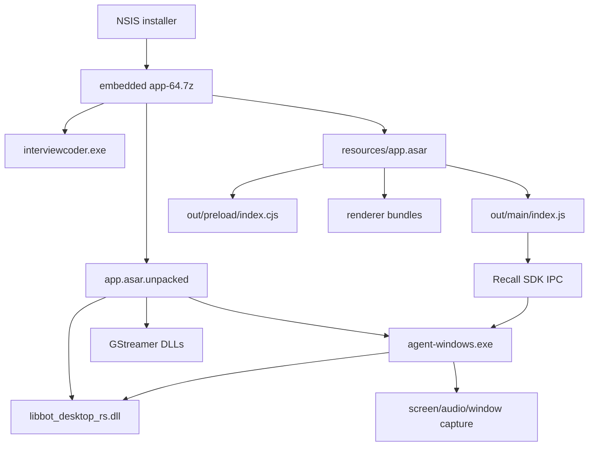

# InterviewCoder 3.0.0 安装包静态逆向报告

日期：2026-11-09
样本：`interviewcoder-setup.exe`
分析方式：离线静态分析；未运行安装器、Electron 主程序、桌面 agent 或任何随包子进程。

## 结论

第一个逆向项目可以处理这个软件包，而且该目标的主要业务逻辑已经可以直接从安装包中恢复到可读的 Electron JavaScript：安装器是 NSIS，内部是 7z，应用是 Electron，核心 ASAR 含主进程、Preload 和 renderer bundle。桌面采集链由 Electron 主进程、Recall Desktop SDK、`agent-windows.exe` 和 `libbot_desktop_rs.dll` 组成。

当前静态分析已经确认了以下链路：

1. Electron 主进程创建一个置顶、透明、跳过任务栏并启用屏幕内容保护的窗口。
2. 主进程把平台访问令牌注入到 InterviewCoder 页面和平台请求中。
3. renderer 通过受限的 Preload IPC 调用主进程。
4. 主进程把录制请求转给 Recall SDK；SDK 再以 JSON 行协议启动 `agent-windows.exe`。
5. agent 负责桌面窗口/屏幕、麦克风和系统音频采集，并向 Recall 上传录制结果及实时转写事件。

这些是静态代码事实。是否在特定版本、特定账户或特定会议场景中实际采集、上传和触发哪些接口，仍需隔离 Windows 虚拟机动态验证。

## 样本与指纹

| 文件 | SHA-256 | 类型 |
|---|---|---|
| `interviewcoder-setup.exe` | `37843b027f36c67153bf16fae40d94fc3542d765a5a41cb67e7fc39755a96f39` | NSIS-3 Unicode 安装器，PE32 x86 stub |
| `app.asar` | `25b7be8bc102de71ab58bf828a30818edaf2071f91876ac444803c45da0000c6` | Electron ASAR，206,918,681 bytes |
| `interviewcoder.exe` | `05220d69baed1ec63c11566a7409188491157b258dadf3c8a8362f3419fbc9c2` | Electron/Chromium PE32+ x64 GUI |
| `agent-windows.exe` | `ff73741d00865dec7e68ca6d9b204132af8126ec1f344982b7318f7215e546ee` | Rust x64 console PE |
| `libbot_desktop_rs.dll` | `7fa8faf0ef6c270b7d3092d83510a12a52cd21733cd614a565404bd503e1da6b` | Rust x64 DLL |

ASAR 头部显示数据起点为 `4,872,102`，共 18,654 个文件条目。应用包声明版本 `3.0.0`，入口为 `out/main/index.js`。原始 ASAR 内的 `package.json` 末尾缺少根对象的最后一个 `}`；这被记录为样本现象，提取脚本不会擅自修复它。

## 解包结构



## 关键证据

### 更新链

主进程把更新源设为 generic provider：`https://downloads.v2.interviewcoder.co/downloads/`，启动后检查更新，下载完成后调用 `quitAndInstall()`。证据见 [`evidence/main-index-snippets.txt`](../evidence/main-index-snippets.txt) 的 `main/index.js` 137–164 行和 [`evidence/artifact-metadata.txt`](../evidence/artifact-metadata.txt) 的 `app-update.yml`。

### 窗口、隐藏和防截屏行为

主窗口使用 `alwaysOnTop`、透明无边框、`skipTaskbar`，并在 `restoreUndetectability()` 中启用 `setContentProtection()`；同一函数在截图前临时强制打开内容保护，截图结束后恢复。证据见 `main/index.js` 174–235、340–346、485–503、1916–1925 行。

### 页面、令牌和 IPC

Preload 只暴露 `ipcRenderer.send/invoke/on` 以及有限的进程信息，没有暴露完整 Node API。主进程把内存中的访问令牌写入 `x-desktop-access-token`，并为平台请求补 `Authorization: Bearer <token>` 与 `X-Trace-Id`。当前实现中的来源判断函数 `Ut()` 恒返回 `true`，所以令牌注入实际由 URL origin 和 referrer 条件控制。证据见 `out/preload/index.cjs` 和 `main/index.js` 578–602、867–1025、2058–2182 行。

主进程还把来自 InterviewCoder 页面 `/ipc/*` 的请求重定向到自定义 `chrome-extension://ipc/*` 协议；内置 IPC 路由包含退出、更新、登录、监听会话、自动启动、快捷键和设置操作。路由响应设置了 `Access-Control-Allow-Origin: *`，这是后续动态阶段需要重点验证的本地 IPC 边界。

### 屏幕和音频采集

主进程注册 Electron `setDisplayMediaRequestHandler`，自动选择显示器并返回 `audio: "loopback"`；截图使用 `desktopCapturer`，Linux 测试路径还会调用 `xwd`/ImageMagick。证据见 `main/index.js` 1916–2021、2326–2355 行。

Recall 初始化在 Windows 上使用 `https://us-west-2.recall.ai`，配置 `restartOnError: true`；录制相关 IPC 包含创建上传 token、准备桌面音频、开始/停止/暂停/恢复/上传录制。创建上传 token 时，主进程向 `${platformApiUrl}/desktop/recall/create-upload-token` 发 POST，并将 bearer token 和 provider 配置发送到后端。证据见 `main/index.js` 1611–1722、1730–1835 行。

### Native agent 协议

`@recallai/desktop-sdk/index.js` 在 Windows 中查找并启动 `agent-windows.exe`，设置 `GST_PLUGIN_PATH`、`GST_DEBUG`、`GST_DEBUG_DUMP_DOT_DIR` 和 `RUST_BACKTRACE`。Electron 通过 stdin 每行发送 JSON：`{command, commandId, params}`；agent 通过 `recall_ai_command|` 前缀的 JSON 行返回 response/event。可见命令包括 `init`、`shutdown`、`startRecording`、`stopRecording`、`pauseRecording`、`resumeRecording`、`uploadRecording` 和 `prepareDesktopAudioRecording`。证据见 [`evidence/desktop-sdk-snippets.txt`](../evidence/desktop-sdk-snippets.txt) 以及 `native-strings.txt`。

`agent-windows.exe` 导入 D3D11、WinRT、音频设备、网络、加密和 `libbot_desktop_rs.dll`；Rust 字符串显示 Windows Graphics Capture、音频捕获、Zoom、Microsoft Teams、Google Meet、WholeDesktop、GStreamer、实时转写和上传配置。`libbot_desktop_rs.dll` 还导入 GStreamer 的 audio/video/base/app 库，字符串包含 `desktop_window_id`、`realtime_endpoints`、`transcriber_credentials`、`video_mixed_mp4`、`audio_mixed_mp3` 和 Recall 内部上传路径。这里只能证明代码路径和能力存在，不能单凭字符串证明运行时一定发送了某个具体文件。

## 初步安全关注点

这些是值得动态验证的审查点，不等同于已确认漏洞：

1. **本地自定义协议边界**：`chrome-extension://ipc/*` 路由将页面请求映射到主进程操作，且响应带 `Access-Control-Allow-Origin: *`。应在隔离 VM 中确认哪些来源能触发 `/app/quit`、`/app/listen/*`、`/app/settings/*` 等操作。
2. **令牌注入范围**：访问令牌保存在主进程内存中，并在满足 origin/referrer 条件时注入 HTTP 头。应验证页面导航、iframe、外部链接和重定向是否可能扩大令牌暴露面。
3. **更新信任边界**：更新源使用 generic provider。应检查安装包签名、`latest.yml`、下载包签名验证和降级行为，不能只依据 HTTPS 判断更新安全性。
4. **采集权限与数据流**：Windows 路径配置为“不需要权限”，但 agent 能采集桌面、窗口、麦克风和系统音频。应在动态测试中记录设备选择、上传请求、缓存目录和录制结束后的清理行为。
5. **native 崩溃/重启**：SDK 对 agent 异常退出最多自动重启 10 次。应验证崩溃日志、临时文件和录制 token 是否在重启过程中重复使用或残留。

## 当前未做的事情

- 没有运行 `interviewcoder-setup.exe`、`interviewcoder.exe`、`agent-windows.exe` 或任何 DLL。
- 没有登录、连接 InterviewCoder/Recall 服务或发送网络请求。
- 没有修改安装包、ASAR、PE 或原始文件。
- 没有使用 IDA/调试器打开 native PE；本轮先完成 Electron/协议静态定位。

## 下一阶段建议

在授权的 Windows 隔离虚拟机中按以下顺序继续：

1. 记录安装前后文件、注册表、计划任务和自动启动项变化。
2. 仅使用测试账户，设置 hosts/代理记录更新域名、平台 API、Recall API 和 WebSocket 连接。
3. 观察主进程与 `agent-windows.exe` 的进程树、stdin/stdout、临时文件和 GStreamer 加载路径。
4. 对 `chrome-extension://ipc/*` 和 renderer 到平台的请求做来源、令牌和权限矩阵测试。
5. 最后再用 IDA/Ghidra 分析 `agent-windows.exe` 与 `libbot_desktop_rs.dll` 的关键命令分发和上传函数。

## 可复现材料

- [`tools/extract_interviewcoder_static.py`](../tools/extract_interviewcoder_static.py)：只做 NSIS/7z 解包、ASAR 头解析和哈希清单，不启动任何样本。
- [`evidence/artifact-metadata.txt`](../evidence/artifact-metadata.txt)：PE、哈希、更新配置和 CSP。
- [`evidence/main-index-snippets.txt`](../evidence/main-index-snippets.txt)：主进程精确行号摘录。
- [`evidence/desktop-sdk-snippets.txt`](../evidence/desktop-sdk-snippets.txt)：Recall SDK 启动和 JSON 行协议摘录。
- [`evidence/native-strings.txt`](../evidence/native-strings.txt)：native agent/DLL 的筛选字符串证据。

复现命令示例：

```bash
python3 tools/extract_interviewcoder_static.py \
  /path/to/interviewcoder-setup.exe \
  --sevenzip /path/to/7zz \
  --out /tmp/interviewcoder-static
```

该命令的预期行为是只生成解包目录和 `static-summary.json`，不会启动安装器或应用。
